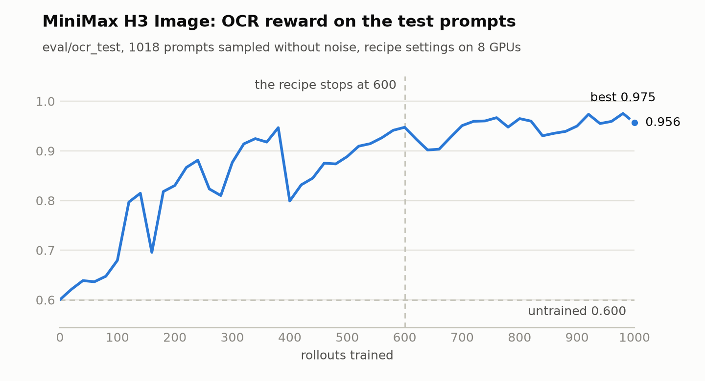
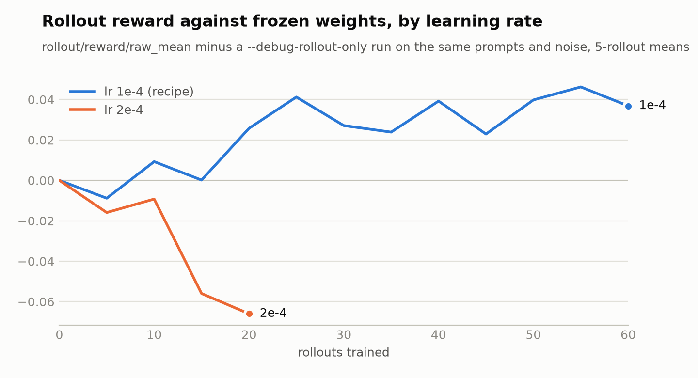

## 1. Model introduction

[MiniMax-H3-Image](https://huggingface.co/MiniMaxAI/MiniMax-H3-Image) is the image release of the H3 family: the H3
DiT (about 33B parameters) without the audio rows, serving text-to-image and image editing. The release is
step-distilled to **6 steps**: the DiT has one output head per denoising step and the checkpoint fixes the sigma
grid, so the step count and the flow shift are not knobs. CFG is distilled in as well, so the recipe is unguided
(`--diffusion-guidance-scale 1.0`).

miles-diffusion trains the **t2i** path with **LoRA**. Editing is served by the rollout engine but has no recipe, and
full-weight training is not supported yet (§ 5).

## 2. Supported variants

| Model | HF ID | Notes |
|---|---|---|
| MiniMax-H3-Image | [`MiniMaxAI/MiniMax-H3-Image`](https://huggingface.co/MiniMaxAI/MiniMax-H3-Image) | Family key `h3_image`; t2i Flow-GRPO with LoRA |

A name containing `minimax-h3-image` or `minimax_h3_image`, or a local path ending in `/h3-image` or `/h3_image`,
resolves to this family. Matching keeps the longest pattern, so the id does not resolve to `h3`.

The repo ships the same weights in two layouts. The rollout engine loads the native one (`transformer/`, named by
`model_index.json`); the trainer loads the Diffusers one (`transformer_diffusers/`, named by
`modular_model_index.json`), which the loader reads first when a checkpoint ships it. Both sides are addressed as
`transformer`.

## 3. Family config

From `miles/backends/fsdp_utils/configs/h3_image.py`, a subclass of the [H3](h3.md) family:

| Property | Value | Why |
|---|---|---|
| Tasks | `t2i` | The forward rejects a layout with reference rows |
| Loss | `policy_loss` only (asserted) | The forward picks the output head by the pair's rollout step, which only the Flow-GRPO prepare hook sets |
| Steps | 6 for rollout and eval (asserted) | One output head per step of the release's grid |
| Weight sync | LoRA adapters only (asserted) | The engine keeps the per-step heads outside its parameters and cannot receive them |
| LoRA targets | `attn.to_{q,k,v}`, `attn.to_out.0`, `ff.net.0.proj`, `ff.net.2` | H3's; the engine's `lora_merge` maps and fuses them |
| Forward | `t = 1 - sigma`, `pdd_step_index` = the pair's step, output negated | H3 predicts clean − noise; the shared objective predicts noise − clean |
| Micro-batch | one pair per forward (asserted) | One packed sequence per forward |
| Forced sampling params | `min_generation_area = width × height` | By default the engine generates a small request on a 2048² canvas and resizes it back |
| CFG training | Off (asserted) | CFG is distilled into the checkpoint |

## 4. Launch

Canonical recipe: `scripts/run_diffusion_grpo_h3_image_ocr_8gpu.py` — FSDP DP=8 colocated with four TP2 rollout
engines on 8 GPUs, 512×512, OCR reward, LoRA synced over CUDA IPC.

**Status:** [📈 V — Verified](../../user-guide/recipe-verification.md#v), see § 6.1.

```bash
python3 scripts/run_diffusion_grpo_h3_image_ocr_8gpu.py

# alignment diagnostic: freeze the weights, so the debug metrics measure
# train-vs-rollout deviation rather than parameter drift
python3 scripts/run_diffusion_grpo_h3_image_ocr_8gpu.py \
  --num-rollout 2 --eval-interval 0 --extra-args "--debug-skip-optimizer-step"

# frozen-weights control: rollouts only, the reference a run's rollout reward is read against (§ 5)
python3 scripts/run_diffusion_grpo_h3_image_ocr_8gpu.py \
  --num-rollout 60 --eval-interval 0 --save-interval 100000 --extra-args "--debug-rollout-only"

# local checkpoint
python3 scripts/run_diffusion_grpo_h3_image_ocr_8gpu.py \
  --extra-args "--hf-checkpoint /path/to/MiniMax-H3-Image"
```

What to watch:

| Signal | Where | Reading |
|---|---|---|
| Reward | `eval/ocr_test`, `rollout/reward/raw_mean` | Eval is the 1018-prompt test split, sampled without noise, so two evals differ only by the weights. The rollout reward follows the 8 prompts of its rollout (0.47 to 0.84 on the base model) |
| Rollout vs train | `train/model_output_mean_abs_diff`, `train/prev_mean_diff_over_noise_std` | The trainer's forward and transition mean against the engine's own (`--diffusion-debug-mode`); about 0.02 and 0.018 on a rollout's first optimizer step of the base model. They should not grow: over 1000 rollouts they fell to 0.010 and 0.007 |
| PPO ratio | `train/clipfrac`, `train/log_prob_mean_abs_diff` | 0 on a rollout's first optimizer step (the old log-prob is recomputed by the trainer), then how far that step moved the policy |
| Memory | `nvidia-smi`, `train/device_memory_used_gb` | A GPU peaks near 69 GB, during a rollout (its TP2 engine rank). While training, the engine is offloaded and about 24 GB are in use |

## 5. Recipe notes

- **`cps`, not flow-`sde`.** On the release's 6-step grid, flow-SDE noise costs image quality in proportion to its
  level: against the noise-free rollout of the same prompt and seed, PickScore drops by 0.004 at noise level 0.3, 0.016
  at 0.5 and about 0.04 at 0.7, with visible grain. `cps` at 0.8 costs none, on any window (sgl-project/sglang#51113).
- **Every step but the last is noisy and trained** (`--diffusion-num-sde-steps 5 --diffusion-sde-window-range 0,5`).
  The last step ends at sigma 0, where `cps` adds no noise. With a 2-step window, the reward of 8 fixed prompts rose
  half as fast per rollout (§ 6).
- **The engine applies the adapters at forward time** (`--sglang-lora-merge-mode dynamic`). Merged into the bf16
  weights, the engine drifts from the trainer as the adapters grow: on a rollout's first optimizer step,
  `train/model_output_mean_abs_diff` went from 0.020 to 0.030 in 25 rollouts. With `dynamic` it stays at 0.020, and a
  sync takes 1.2 s instead of 11.5 s; a rollout takes 14 s instead of 8 s.
- **The trainer recomputes the old log-probs** (`--diffusion-recompute-old-log-prob`). On the base model the engine's
  and the trainer's log-probs differ by 0.7e-4 to 1.7e-4, the size of the clip range (`1e-4`): scored against the
  engine's, 20-47% of the pairs are clipped before any update.
- **lr 1e-4, 2 optimizer steps per rollout.** The learning rate decides whether the adapters generalize. At 2e-4 the
  recipe fits 8 fixed prompts 1.5 times as fast as at 1e-4, and on the full dataset gets worse on every prompt it has
  not trained on: `eval/ocr_test` falls from 0.600 to 0.550 in 20 rollouts. At 1e-4 it rises to 0.621, and to 0.948
  after 600 (§ 6). lr 3e-4 with a 3e-4 clip range and 4 optimizer steps took it to 0.37 in 10 rollouts.
- **Tune on `eval/ocr_test`, not on the reward of a fixed prompt set**, which rises fastest for the settings that
  generalize worst. For a reading before the next eval, run the frozen-weights control of § 4 once:
  `--deterministic-mode` gives rollout k the same prompts and noise in every run, so a run's
  `rollout/reward/raw_mean` minus the control's is its gain on prompts it has not seen. Rollout 0 differs by exactly 0.
- **No gradient checkpointing.** One pair per forward peaks at 16 GB on the trainer, and checkpointing made the
  training phase a third longer (64 s against 47 s).
- **Cost.** About 73 s per rollout on 8 H200: 14 s to generate and score 128 images, 47 s to train on their 640
  pairs, the rest to move the engines and the trainer on and off the GPUs. With the evals, the recipe's 600 rollouts
  take 13 hours.
- **Engine.** MiniMax-H3-Image rollouts need sgl-project/sglang#51113 in `sglang-miles`. The checkpoint must ship both
  layouts (§ 2).
- **LoRA only.** The engine keeps the DiT's per-step output heads outside its parameters and cannot receive them, so
  the family refuses a run that trains without `--use-lora`.

## 6. Reference results

### 6.1 The recipe on the full dataset

One run of the recipe's settings on 8 H200, 1000 rollouts in 22 hours. The recipe stops at 600 (76,800 images, 13
hours); the learning rate is constant, so its run is the first 600 rollouts of this one.

| Rollouts trained | 0 | 100 | 200 | 300 | 400 | 500 | 600 | 700 | 800 | 900 | 1000 |
|---|---|---|---|---|---|---|---|---|---|---|---|
| `eval/ocr_test` | 0.6003 | 0.6795 | 0.8303 | 0.8768 | 0.7991 | 0.8886 | 0.9475 | 0.9510 | 0.9650 | 0.9500 | 0.9565 |



- **Most of the gain comes in 600 rollouts.** The eval first passes 0.90 after 320 rollouts and is 0.948 after 600.
  The 400 rollouts after that add about 0.01: the evals from 700 on lie between 0.930 and 0.975, the best after 980.
- **The eval is not monotonic.** It fell 0.12 below its best so far after 160 rollouts, 0.07 after 280 and 0.15 after
  400, and came back each time; the last of these took 200 rollouts. Later drops are 0.05 or less. The eval has no
  sampling noise, so each value is what the weights of that rollout score. A checkpoint is saved with every eval
  (`--save-interval 20`): pick one by its eval, not the last one written.
- **The trainer stays aligned with the engine.** `train/model_output_mean_abs_diff` on a rollout's first optimizer
  step, averaged over 100 rollouts, goes from 0.021 to 0.010. `train/clipfrac` on the second optimizer step, averaged
  over 20 rollouts, stays below 0.32.
- **The run is reproducible.** A second launch reproduced the first 20 rollouts' rewards and the eval after them
  exactly.

### 6.2 The first rollouts, by learning rate

The last column is `rollout/reward/raw_mean` over rollouts 10-19 minus the same rollouts of a `--debug-rollout-only`
run (same prompts, same noise, frozen weights):

| lr | `eval/ocr_test` at rollout 0 | After 20 rollouts | Rollout reward against frozen weights |
|---|---|---|---|
| 1e-4 (recipe) | 0.6003 | 0.6213 | +0.013 ± 0.007 |
| 2e-4 | 0.6003 | 0.5500 | −0.061 ± 0.013 |



### 6.3 Fitting 8 fixed prompts

The same 8 train prompts every rollout, 25 rollouts, slope of `rollout/reward/raw_mean` per rollout. This measures
how fast a setting fits its prompts, not whether it generalizes (§ 5):

| Noisy steps | lr | Engine LoRA | Reward per rollout | First-step `model_output_mean_abs_diff`, start → end |
|---|---|---|---|---|
| 2-step window | 1e-4 | merged | +0.0018 ± 0.0007 | 0.024 → 0.032 |
| 5 | 1e-4 | merged | +0.0038 ± 0.0008 | 0.022 → 0.031 |
| 5 | 2e-4 | merged | +0.0058 ± 0.0008 | 0.026 → 0.030 |
| 5 | 2e-4 | dynamic | +0.0051 ± 0.0010 | 0.020 → 0.020 |

## 7. Pairs well with

- [MiniMax H3](h3.md) — the video family this one subclasses.
- [SDE Step Backend](../../advanced/sde-backend.md) — `cps` and flow-`sde`, and the alignment checklist.
- [LoRA Training and Weight Sync](../../advanced/lora.md) — the IPC merge (`--lora-ipc-weight-sync` with `--colocate`) the recipe uses.
