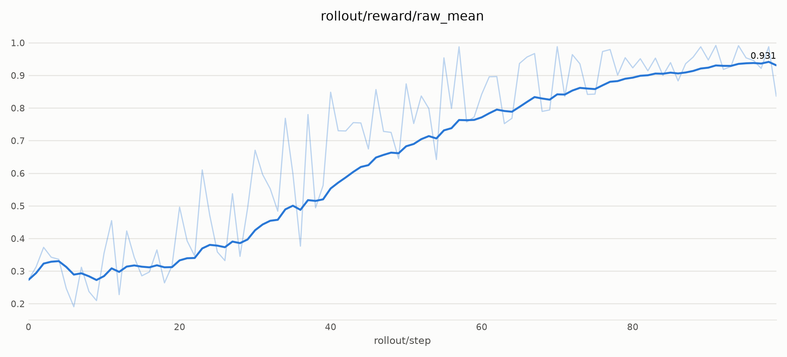
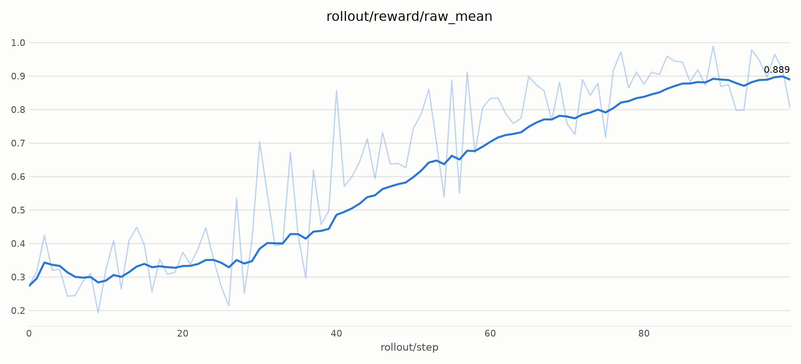
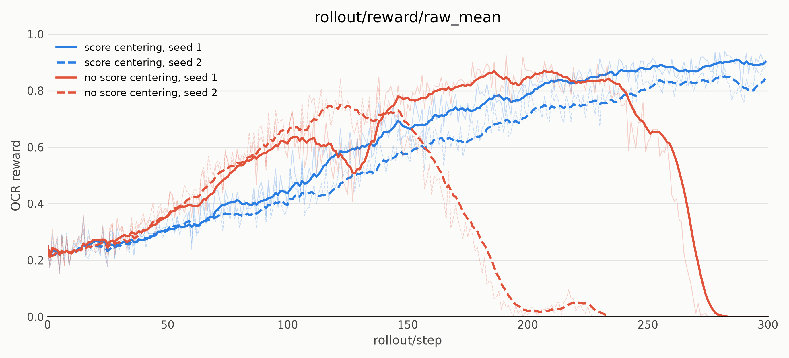
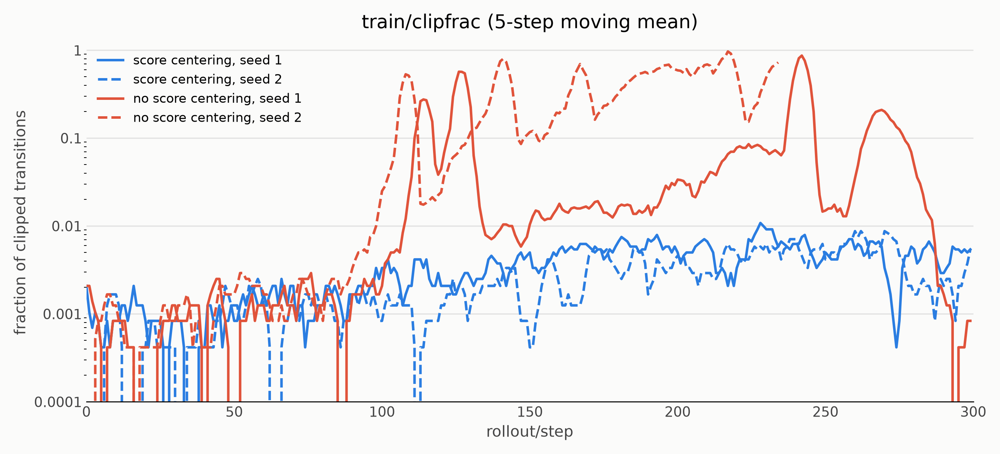
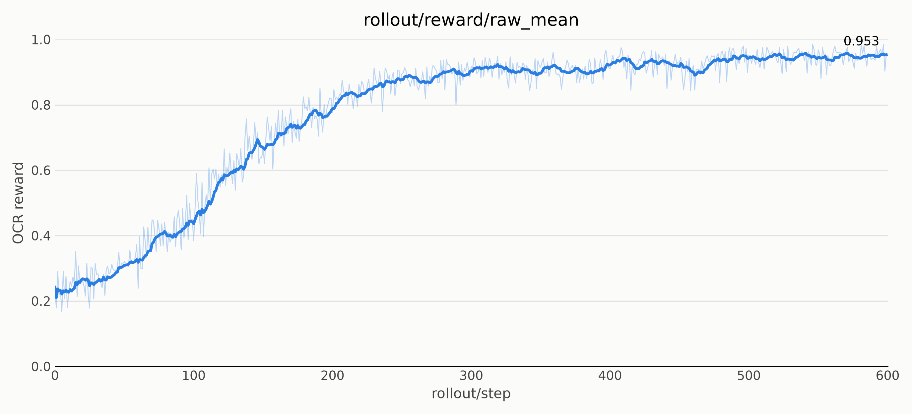
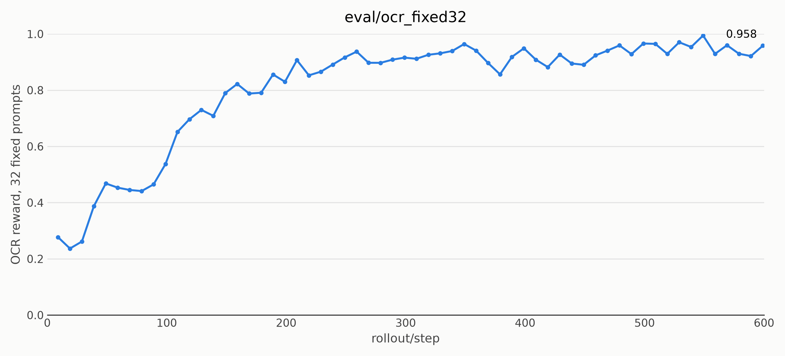

## 1. Model introduction

[Krea-2-Raw](https://huggingface.co/krea/Krea-2-Raw) is a text-to-image flow-matching DiT. Its rollout runs on
sglang-diffusion at 1024×1024 in bf16.

## 2. Supported variants

| Variant | HF checkpoint | Status |
| --- | --- | --- |
| Raw | [krea/Krea-2-Raw](https://huggingface.co/krea/Krea-2-Raw) (gated: needs `HF_TOKEN`) | Recipes below |

## 3. Family config

From `miles/backends/fsdp_utils/configs/krea2.py`:

| Property | Value | Why |
| --- | --- | --- |
| Rollout microgroup | 1 (validated) | The engine serves one output per request |
| Cond collation | Pad text to the batch max; one latent grid per batch | Position ids of the grid depend only on resolution |
| Text mask | Dropped when every token is valid | Matches the rollout DiT's maskless fast path |
| CFG combine | `neg + scale · (pos − neg)`, `true_cfg_scale` wins when set | Same formula as the engine |
| FSDP param dtypes | RMSNorm weights in fp32 | `models/diffusers/krea2/parallel_plan.py`; `weight + 1.0` loses small offsets in bf16 |

## 4. Launch

§4.1–4.3 train DiffusionNFT with the OCR reward (no reward GPU), LoRA rank 32, an EMA rollout policy and
deterministic ODE rollouts (10 steps, no CFG). §4.4 trains Flow-GRPO on the same data and LoRA with SDE rollouts.

### 4.1 Synchronous, 2 GPUs colocated

`scripts/run_diffusion_nft_krea2.py` — FSDP DP=2 sharing the GPUs with two sglang engines; LoRA adapters sync over
CUDA IPC. 8 prompts × 8 samples per step, micro-batch 2 with gradient checkpointing.

**Status:** [📈 V — Verified](../../user-guide/recipe-verification.md#v)

```bash
python3 scripts/run_diffusion_nft_krea2.py
```

### 4.2 Synchronous, 8 GPUs colocated

`scripts/run_diffusion_nft_krea2_8gpu.py` — runs `train_diffusion.py`: FSDP DP=8 shares the GPUs with eight sglang
engines, and the LoRA adapters sync over CUDA IPC. 6 prompts × 8 samples per step, micro-batch 2 with gradient
checkpointing, since the engines take part of every GPU.

**Status:** [📈 V — Verified](../../user-guide/recipe-verification.md#v)

```bash
python3 scripts/run_diffusion_nft_krea2_8gpu.py
```

### 4.3 Asynchronous, 6 training + 2 rollout GPUs

`scripts/run_diffusion_nft_krea2_async.py` — runs `train_diffusion_async.py`: each batch is sampled under the EMA while
the previous batch trains, on separate pools; LoRA adapters sync to the rollout engines over NCCL. Same batch as §4.2
(6 × 8 per step), micro-batch 4, no gradient checkpointing.

**Status:** [🧩 PG — Proxy gated](../../user-guide/recipe-verification.md#pg) by
`tests/e2e/short/test_krea2_nft_ocr_async_8xGPU_4xGPU_proxy.py`, which runs `--four-gpu-ci`: half of each pool and of
the batch (3 training + 1 rollout GPUs, 3 × 8 per step), so every training GPU keeps the production micro-batches.

```bash
python3 scripts/run_diffusion_nft_krea2_async.py
```

### 4.4 Asynchronous Flow-GRPO with score centering (experimental) and an fp8 rollout, 4 training + 4 rollout GPUs

`scripts/run_diffusion_grpo_krea2_async.py` — the Flow-GRPO loss with SDE rollouts (noise level 0.7, no CFG), two SDE
steps per sample (steps 3–4 of 10), 30 prompts × 8 samples per step, PPO clip `1e-4`, no KL, no EMA, micro-batch 2,
300 rollouts. The rollout engines run the DiT in fp8 (`--sglang-quantization fp8`) and apply the LoRA adapters on the
fly (`--sglang-lora-merge-mode dynamic`), since adapters cannot be merged into fp8 weights; training stays bf16. Rollout
tensors reach the trainer through the output store (`--use-output-store`; the launcher starts the Mooncake master).

The engines sample each batch with the previous step's actor weights, so the trainer re-scores transitions drawn around
a mean it no longer owns, and the fp8 engine moves that mean further. The experimental `--diffusion-score-centering` (with
`--diffusion-debug-mode`) removes the drift this puts into the PPO gradient, see
[SDE Step Backend §5 (experimental)](../../advanced/sde-backend.md#5-score-centering-experimental). `--no-score-centering` runs the plain
one-step-async baseline with everything else unchanged.

**Status:** [📈 V — Verified](../../user-guide/recipe-verification.md#v), see §5.3 and §5.4.

```bash
python3 scripts/run_diffusion_grpo_krea2_async.py
```

## 5. Reference results

§5.1 and §5.2 use the default seed (1234) and 100 rollouts. `eval/ocr_test` is the held-out OCR accuracy over 1018
prompts at 52 denoising steps, measured after the last rollout.

### 5.1 Synchronous, 8 GPUs colocated

The OCR reward (`rollout/reward/raw_mean`) rises from ~0.28 (mean of the first 10 rollouts) to ~0.94 (mean of the last
10), at ~94 s per rollout; `eval/ocr_test` ends at 0.923:



### 5.2 Asynchronous, 6 training + 2 rollout GPUs

The OCR reward rises from ~0.29 to ~0.88, at ~79 s per rollout; `eval/ocr_test` ends at 0.875:



NFT varies a lot from seed to seed. Over seeds 1234, 4321 and 2026, the mean OCR reward of the last 10 rollouts is
0.942, 0.905 and 0.907 for §5.1 and 0.885, 0.827 and 0.940 for §5.2.

### 5.3 Asynchronous Flow-GRPO, with and without score centering (experimental)

The §4.4 recipe as is and with `--no-score-centering`, two seeds each. Seed 1 uses the defaults
(`--seed 1234 --rollout-seed 42`) and was resumed once from its rollout-200 checkpoint; seed 2 adds
`--extra-args "--seed 2026 --rollout-seed 2026"`. These runs predate the switch to the output store and used the
§5.4 eval; neither changes training.

The fp8 engine puts the trainer-vs-rollout log-prob gap (`train/log_prob_mean_abs_diff`) at ~3e-5, about four times
the bf16 gap and a third of the `1e-4` clip range. Without score centering the reward rises faster at first, but both
seeds go through bursts in which most transitions are clipped, and the reward then falls to 0: seed 1 near rollout 270,
seed 2 near rollout 200 (stopped at rollout 235, when every sample scored 0). With score centering the clip fraction
stays below 1.7% and the reward keeps rising; the mean of the last 10 rollouts is 0.902 for seed 1 and 0.842 for seed 2.





### 5.4 Score centering (experimental) over 600 rollouts

Seed 1 with score centering, continued to `--num-rollout 600`. The OCR reward rises from ~0.23 (mean of the first 10
rollouts) to ~0.95 (mean of the last 10), and the clip fraction falls from 0.52% on average over rollouts 200–299 to
0.15% over rollouts 500–599. `eval/ocr_fixed32` scores 32 fixed prompts from the OCR test split at 40 denoising steps
every 10 rollouts (`--eval-prompt-data ocr_fixed32 <file> --eval-interval 10 --diffusion-eval-num-steps 40` in place of
the recipe's eval); it ends at 0.958:





## 6. Pairs well with

- [LoRA Training and Weight Sync](../../advanced/lora.md) — IPC and NCCL adapter sync.
- [Rewards](../../user-guide/rewards.md) — the OCR reward.
