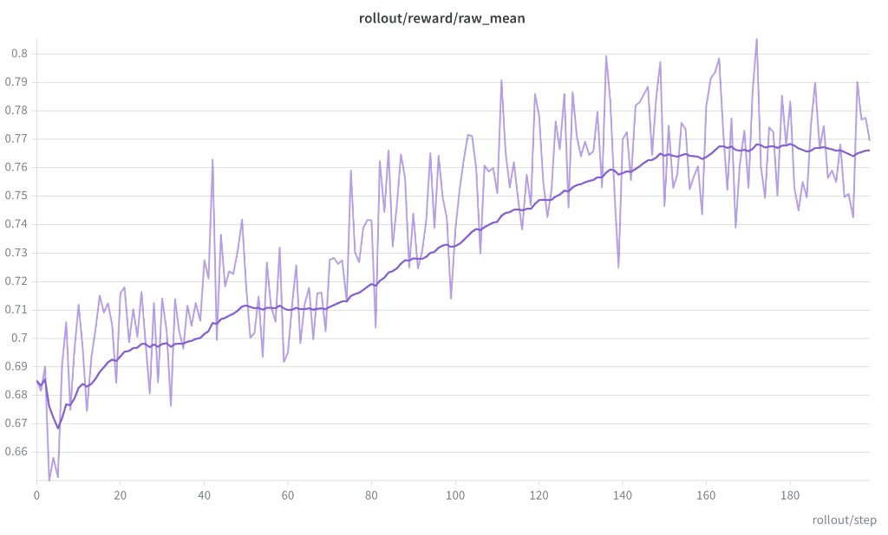

## 1. Model introduction

[LTX-2](https://github.com/Lightricks/LTX-2) is Lightricks' audio-video DiT. LTX-2.3 is the
variant miles-diffusion trains, and the framework's most unusual family: like FLUX 3 Image Klein it
does **not** go through diffusers (it trains a native model package), it is the only one on the **CPS**
SDE kernel, and, like MiniMax H3, it is trained **unguided**.

**Key highlights for RL training:**

- **Native model package, not diffusers.** `miles/backends/fsdp_utils/models/ltx/` supplies
  loading, modeling, attention, and the FSDP plan directly against `ltx_core`; FSDP wraps
  `BasicAVTransformerBlock`. Requires `ltx-core` (pinned in `requirements.txt`, baked into the
  Docker image).
- **Unguided training.** `supports_cfg_training = False`: any `--diffusion-guidance-scale` other
  than `1.0`, or a `--diffusion-negative-prompt`, is a parse-time error. The training forward is
  a single velocity pass — there is no negative branch to combine.
- **Video alone, or video with audio.** By default only the video stream is trained: the
  forward passes no audio, and `--rollout-patch-group ltx` turns the engine's audio-video
  cross-attention off to match. With `--rollout-extra-streams audio --rollout-patch-group ltx_av`
  the engine also rolls out the audio stream with cross-attention on, and the trainer replays the
  joint forward `model(video=..., audio=...)`; each step's action is both streams' next latents
  (see [§5](#5-recipe-notes)).
- **No sequence parallelism.** `sequence_parallel_plan` raises `NotImplementedError`; leave
  `--sequence-parallel-size` at `1`.

## 2. Supported variants

| Model | HF ID | Notes |
|---|---|---|
| LTX-2.3 | [`Lightricks/LTX-2.3`](https://huggingface.co/Lightricks/LTX-2.3) | Video, or video with audio (`--audio`) |

## 3. Family config

Registered in `miles/backends/fsdp_utils/configs/ltx.py`:

| Property | Value | Why |
|---|---|---|
| Velocity → noise | `forward_velocity` reconstructs x0 via `ltx_core.utils.to_denoised` in fp32 and divides back out | Algebraically an identity, but the fp32 rounding path is what the e2e standards were recorded against |
| Boundary dtypes | `latents` / `cond` cast to the forward dtype, `timestep` passthrough | Element-wise math anchors on `latents.dtype` and rollout runs bf16 — see [Dtype Control](../../advanced/dtype-control.md) |
| Precision | bf16 end to end (master, reduce, forward, engine); the trainer runs math-SDPA (`--fsdp-attention-backend sdpa_math`), the engine `torch_sdpa`, where LTX lets PyTorch pick its fused kernels (cuDNN first) | Math-SDPA keeps the training forward deterministic; the e2e standards are recorded with this pairing |
| SDE | CPS kernel | Each train pair carries the σ the engine stepped with, so no scheduler lookup; log-prob is `−(x − μ)²`, without the Gaussian constants or the 1/(2σ²) scale |
| LoRA targets | Attention + FFN: `to_q`, `to_k`, `to_v`, `to_out.0`, `net.0.proj`, `net.2` | |
| Rollout patches | `--rollout-patch-group ltx`: `patch_ltx2_rollout_cond_kwargs`, `patch_ltx2_disable_av_cross`; with audio, `ltx_av`: `patch_ltx2_rollout_cond_kwargs` only | The engine's AV cross-attention must match the training forward: off for video alone, on for the joint forward. `validate_args` rejects audio without `ltx_av`, and `ltx_av` without audio |
| Audio positions | Audio RoPE coordinates in seconds, kept in fp32 | The engine rounds only the video coordinates to the hidden dtype; bf16 audio timestamps put the audio prediction about 17% off, against 1.7% in fp32 |

## 4. Launch

Canonical recipe: `scripts/run_diffusion_grpo_ltx23_sglang.py` — a 5-GPU Ray node with 4 GPUs shared by FSDP and
rollout plus 1 separately scheduled PickScore GPU, 57 frames @ 24 fps, 512×768 (height × width).

**Status:** [🛡️ FG — Fully gated](../../user-guide/recipe-verification.md#fg)

```bash
python3 scripts/run_diffusion_grpo_ltx23_sglang.py
```

`--audio` runs the same recipe on video with audio (`--rollout-patch-group ltx_av --rollout-extra-streams audio`):

```bash
python3 scripts/run_diffusion_grpo_ltx23_sglang.py --audio
```

## 5. Recipe notes

- The step strategy is `epoch_global_random_choice`: 3 SDE steps drawn from candidates 0-9 and
  shared by each block of `--rollout-batch-size` consecutive prompt groups (one rollout, unless a dynamic-sampling filter drops groups) — with only 64 samples per rollout, per-request
  randomization would add variance the batch is too small to average out.
- The clip range is `1e-5`, an order of magnitude tighter than the SD3.5 and Qwen-Image recipes' `1e-4`.
- `--pickscore-num-frames 3` scores three evenly-spaced frames per video; scoring all 57 would
  dominate rollout time for a reward signal that barely changes.
- Health checks are relaxed (`--rollout-health-check-interval 120`, router failure threshold 30).
  Both probes (`/health_generate` from miles, `/health` from the router) only check readiness and
  run no generation, so the relaxed values only make a dead engine take longer to detect.
- `--rollout-parser-num-workers 16`: 57-frame trajectory tensors are large enough that one
  deserializer actor starves the engines.
- With `--audio`, a step's log-prob is the two streams' per-element means weighted by element
  count: a pair holds 393,216 video and 7,552 audio latent elements, so the audio stream carries
  1.9% of the step's log-prob. Both streams run at one noise level on one sigma grid, so their steps
  inject the same noise; that is what keeps the `cps` log-prob (the squared distance, without the
  `1/(2·noise_std²)` scale) weighting the joint action's mean. With different noise levels or grids
  each stream's term would also carry its own `noise_std²`. `train/log_prob_mean_abs_diff_visual`
  and `train/log_prob_mean_abs_diff_audio` report each stream's own gap.
- PickScore scores video frames only, so with `--audio` the audio stream's advantage comes from
  the video's reward.
- With `--audio`, an engine over several GPUs gives them all to TP: `validate_args` rejects audio
  rollout under engine sequence parallelism. Only Flow-GRPO trains the audio stream; NFT, DMD2,
  SFT and `--diffusion-score-centering` do not take `--rollout-extra-streams`.

## 6. Reference results

The original bf16-master 4-train-GPU + 1-reward-GPU run, used as the first LTX E2E
reference, raises `rollout/reward/raw_mean` from ~0.68 to ~0.77 over 200 rollouts:



A future LTX update will make `train/model_output_mean_abs_diff` **0.0** and switch
`--fsdp-master-dtype` to `fp32`.

## 7. Pairs well with

- [Dtype Control](../../advanced/dtype-control.md) — the boundary-dtype policy is why LTX has one.
- [Deterministic Training](../../advanced/deterministic.md) — `sdpa_math` is the deterministic-safe
  backend this recipe relies on.
